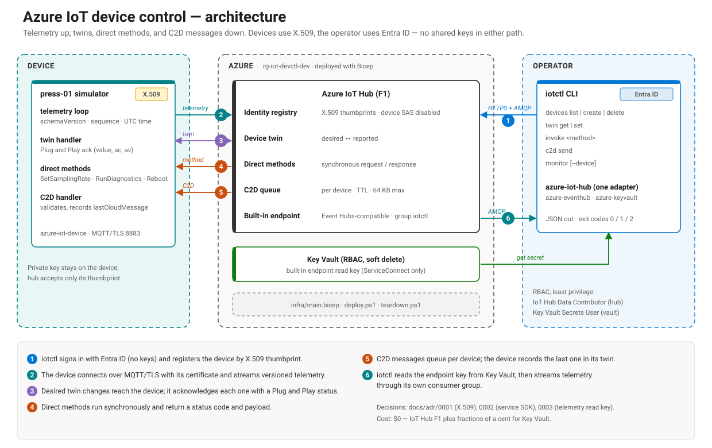

# Azure IoT Device Control

> Two-way control of an industrial device on Azure IoT Hub: telemetry up; device twins,
> direct methods, and cloud-to-device messages down. No shared keys anywhere.



A simulated press streams wear-dependent telemetry to Azure IoT Hub, and an operator CLI
(`iotctl`) manages it from the cloud side. Both sides are built to production habits:
certificate auth, least-privilege RBAC, infrastructure as code, tests, and CI.

## What it demonstrates

| Mechanism | Direction | How it is used |
|-----------|-----------|----------------|
| **Device-to-cloud telemetry** | device → cloud | Versioned JSON (`schemaVersion`, gap-detecting `sequence`, UTC timestamp), routing properties on every message |
| **Device twin** | both | `telemetryIntervalMs` desired → applied or rejected, acknowledged with the IoT Plug and Play convention (`value`, `ac`, `av`, `ad`) |
| **Direct methods** | cloud → device, sync | `SetSamplingRate`, `RunDiagnostics`, `Reboot`, with validated payloads and HTTP-style status codes |
| **Cloud-to-device messages** | cloud → device, async | Typed JSON messages with optional TTL; the device records the last one in its twin |
| **Device identity** | — | Self-signed X.509 (ECDSA P-256) registered by thumbprint, with a secondary thumbprint for rollover |

## Security

- **Devices:** X.509 only. The hub disables device and module SAS keys, so a leaked
  key cannot impersonate a device.
- **Operator:** Microsoft Entra ID via `az login`. No connection strings in code, `.env`, or git.
- **Least privilege:** *IoT Hub Data Contributor* on the hub and *Key Vault Secrets User* on the vault, granted by Bicep.
- **Telemetry read key:** the built-in endpoint does not accept Entra ID, so its
  least-privileged key lives in Key Vault and is fetched at runtime ([ADR 0003](docs/adr/0003-telemetry-read-key-in-key-vault.md)).

## Quickstart

**Prerequisites:** Python 3.11+, Azure CLI (`az login`, `az bicep install`), an Azure subscription
with no existing F1 IoT hub (Azure allows one per subscription).

```powershell
# 1. Python environment
python -m venv .venv; .venv\Scripts\activate
pip install -r requirements-dev.txt

# 2. Azure resources (IoT Hub F1, Key Vault, RBAC) and .env
./infra/deploy.ps1

# 3. Device certificate and identity
python tools/make_device_cert.py press-01
python -m service devices create press-01 --cert certs/press-01-cert.pem

# 4. Run the device (terminal 1)
python -m device

# 5. Operate it (terminal 2)
python -m service monitor --device press-01
python -m service twin set press-01 --desired '{\"telemetryIntervalMs\": 2000}'
python -m service invoke press-01 RunDiagnostics
python -m service invoke press-01 SetSamplingRate --payload '{\"intervalMs\": 1000}'
python -m service c2d send press-01 --type maintenanceScheduled --data '{\"window\": \"Sat 02:00\"}'
python -m service twin get press-01

# 6. Remove everything (and purge the soft-deleted vault)
./infra/teardown.ps1
```

JSON arguments above use Windows PowerShell 5.1 quoting (`\"`); in bash or PowerShell 7 write
`'{"telemetryIntervalMs": 2000}'`. `iotctl` (installed by `pip install -e .`) is the same CLI
as `python -m service`.
Exit codes: `0` success, `1` operation failed, `2` invalid input or configuration.

## Tests and CI

```powershell
ruff check . ; ruff format --check . ; pytest
```

The device logic, twin acknowledgements, method validation, C2D handling, service adapter,
CLI, telemetry formatting, and certificate tool are covered with fakes, so no Azure is needed.
GitHub Actions runs lint, format, and tests on Python 3.12 and 3.13, and compiles the Bicep.

## Project layout

```
device/        simulated press: telemetry contract, twin/method/C2D handlers
service/       iotctl: hub adapter (Entra ID), telemetry monitor, CLI
tools/         self-signed device certificate generator
infra/         Bicep + deploy/teardown scripts
tests/         unit tests with fake IoT clients
docs/          architecture diagram, ADRs, screenshots
```

## Cost

**$0** on IoT Hub F1 (8,000 messages/day). Key Vault costs fractions of a cent. Run
`infra/teardown.ps1` when finished.

## Design decisions

- [ADR 0001](docs/adr/0001-x509-self-signed-device-auth.md): self-signed X.509, device SAS disabled
- [ADR 0002](docs/adr/0002-python-service-sdk.md): Python service SDK behind one adapter (`uamqp` risk documented)
- [ADR 0003](docs/adr/0003-telemetry-read-key-in-key-vault.md): telemetry read key in Key Vault

## Production gaps (deliberate)

| This project | Production practice |
|--------------|---------------------|
| Self-signed certs registered one by one | CA-signed certs with DPS enrollment groups |
| Private keys as PEM files | TPM or secure element |
| Built-in endpoint read with a key | Custom Event Hubs route, Entra ID end to end |
| F1 hub, no SLA | S1+ with scaled units, private endpoints |
| `azure-iot-hub` depends on deprecated `uamqp` | Swap the single adapter for a maintained client |
